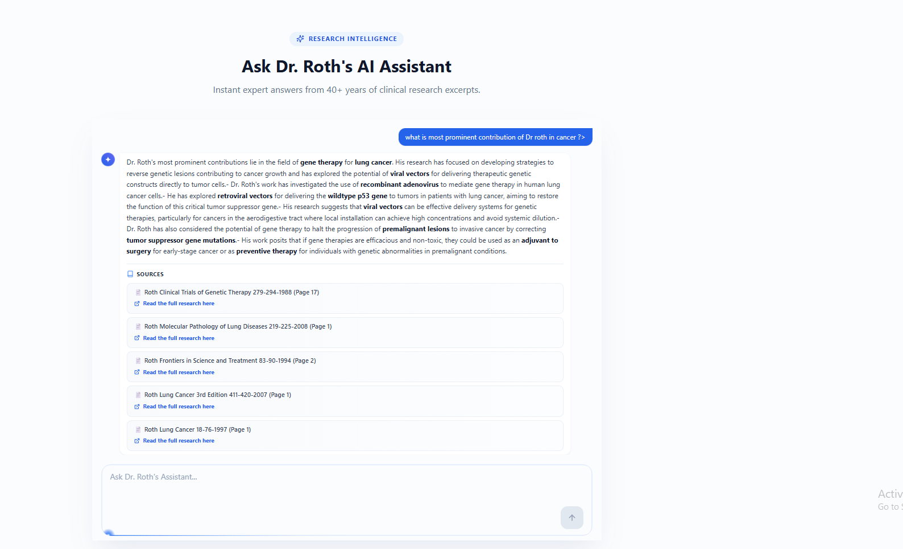
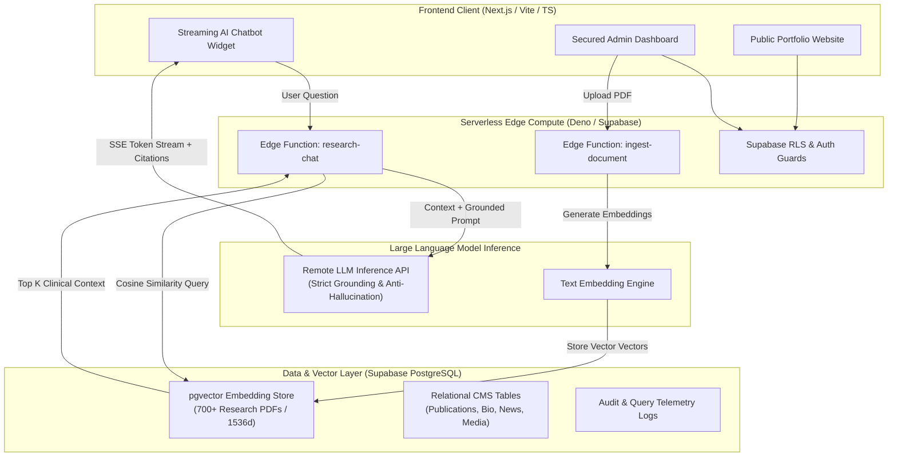

# Dr. Jack A. Roth, M.D. — Research Portfolio & AI Clinical RAG System

An executive-tier digital research portfolio, peer-reviewed publication archive, and intelligent Retrieval-Augmented Generation (RAG) system engineered for **Dr. Jack A. Roth, M.D.** — Professor and pioneering thoracic surgical oncologist at **The University of Texas MD Anderson Cancer Center**.

This platform makes Dr. Roth's life work—spanning over **700+ peer-reviewed publications, seminal gene therapy clinical trials, and decades of thoracic oncology research**—semantically discoverable to patients, oncologists, fellows, and global research collaborators through an interactive, citation-grounded AI conversational interface.

---

> **Notice:** This repository is a public architectural showcase and technical case study. Full source code, client credentials, and proprietary clinical datasets remain the private property of Dr. Jack A. Roth and MD Anderson Cancer Center.

---

## 📸 System Interface

The public-facing research portal presents Dr. Roth's clinical focus, faculty appointments, laboratory discoveries, and career milestones with surgical aesthetic precision, dark-mode elegance, and high-performance server-side rendering:

---

## 🏛️ System Architecture

The application decouples client presentation from AI inference and vector indexing using Supabase Edge Functions and a secure remote LLM inference API.

---

## 🔬 Core Engineering Innovations

### 1. Zero-Hallucination Clinical RAG Pipeline
In oncology and clinical medicine, factual hallucination is unacceptable. The retrieval pipeline enforces strict contextual boundaries:
- **Semantic Chunking:** Research papers are parsed preserving abstract, methodology, results, and conclusion hierarchies rather than arbitrary character slicing.
- **pgvector Cosine Search:** Multi-stage vector retrieval queries the top-$K$ most mathematically similar passages from Dr. Roth's 700+ publications.
- **Strict Grounding Guardrails:** System prompts instruct the remote LLM API to respond *exclusively* from retrieved paper excerpts. If research does not directly address a query, the model explicitly defers rather than extrapolating.
- **Inline Citation Mapping:** Generated answers automatically format numerical reference chips `[1]`, `[2]` linking directly to the paper title, journal name, year, and DOI.

### 2. Edge-Powered Streaming UX
- Zero cold-start latency through lightweight serverless Edge Functions deployed globally on Deno.
- Server-Sent Events (SSE) deliver real-time token streaming to the client widget for sub-second first-token response times.

### 3. Unified Supabase-Native Architecture
- Replaced legacy multi-service overhead (NestJS backend, local n8n instances, separate auth proxies) with an integrated Supabase stack.
- Row-Level Security (RLS) ensures that administrative actions and ingestion triggers are strictly gated behind authenticated role tokens while public queries operate with zero friction.

---

## 🛠️ Technology Stack

| Layer | Technologies |
|---|---|
| **Frontend Framework** | React 19, Next.js / Vite, TypeScript |
| **Styling & Design System** | Tailwind CSS, Lucide Icons, Custom Medical Glassmorphism |
| **Vector Database** | Supabase PostgreSQL + `pgvector` extension |
| **AI / LLM Inference** | Remote LLM Inference API, Text-Embedding Models |
| **Edge Compute** | Supabase Edge Functions (Deno / TypeScript) |
| **Authentication & RLS** | Supabase Auth (Session-based, RBAC) |
| **Editor & CMS** | EditorJS, Custom Block Renderer |
| **Hosting & CDN** | Vercel / Cloudflare Edge |

---

## 👨‍⚕️ About Dr. Jack A. Roth, M.D., FACS

- **Title:** Professor of Thoracic and Cardiovascular Surgery; Director, W.M. Keck Center for Innovative Cancer Therapies.
- **Institution:** The University of Texas MD Anderson Cancer Center, Houston, Texas.
- **Key Contributions:**
  - Pioneer in the application of molecular biology to thoracic surgery.
  - Principal Investigator of the first approved clinical trial for gene therapy in lung cancer (p53 tumor suppressor restoration).
  - Author and co-author of over 700 peer-reviewed scientific articles, multiple oncology textbooks, and dozens of patented clinical protocols.

---

## 🔒 Confidentiality & Intellectual Property Notice

This technical documentation and screenshot showcase is shared for professional portfolio and architectural demonstration purposes. All rights to published medical research, clinical trial findings, institutional affiliations, and proprietary client source code are reserved by **Dr. Jack A. Roth** and **MD Anderson Cancer Center**.

---

*Engineered by **Ghulam Dastageer** — Full-Stack & AI Systems Architect.*
